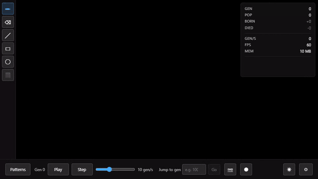
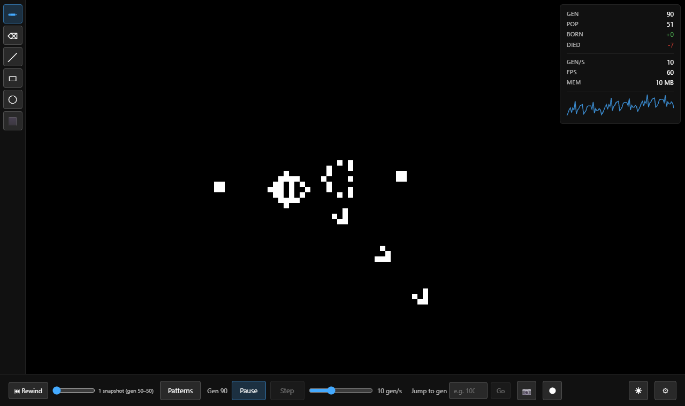
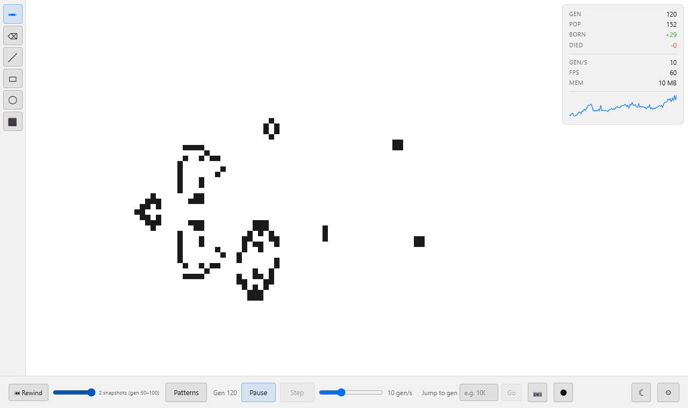
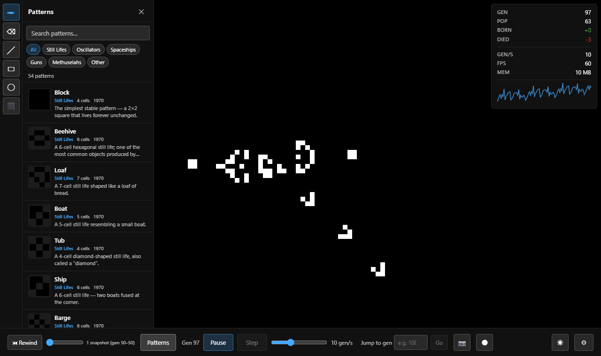

<div align="center">

# Conway's Game of Life

### four rules · infinite canvas · a very long afternoon



_Five cells. Four rules. Watch what happens._

[](#tech-stack)
[](#tech-stack)
[](#tech-stack)
[](#under-the-hood)

**[Live demo](https://conways-life-sim.netlify.app)**

</div>

---

## What is this?

In 1970 the mathematician John Conway invented a "game" with no players. You draw some cells on a grid, press go, and every cell follows the same rules at the same time:

1. A live cell with **2 or 3** live neighbours survives.
2. A dead cell with **exactly 3** live neighbours comes alive.
3. Everything else dies (loneliness, overcrowding, or both).

That's all of it. And yet from those rules you can build gliders that walk across the grid, guns that fire them forever, and, if you're patient enough, a working computer inside the simulation. People have built Life inside Life. It's turtles all the way down.

This is a fast, pleasant place to play with it: GPU rendering, an engine that can jump billions of generations ahead, a proper drawing toolkit, and a library of 54 famous patterns to drop in and watch.

<p align="center">
  
  
</p>

---

## Features

- **Infinite canvas.** Pan and zoom freely. The grid has no edges, so gliders never get to "hit the wall".
- **WebGL2 rendering.** Huge populations stay smooth because the GPU does the drawing.
- **HashLife engine.** Memoised quadtrees let the simulator skip ahead enormous distances. Type a generation number into **Jump to gen** and go.
- **Drawing toolkit.** Pencil, eraser, line, rectangle, ellipse and flood fill, plus lasso and rectangular selection with copy, paste and transforms.
- **Time travel.** Snapshots are taken as it runs. Drag the slider (or hit **Rewind**) to go back and try a different timeline.
- **Pattern library.** 54 patterns across still lifes, oscillators, spaceships, guns and methuselahs, with search, category filters, discoverer and year.
- **Live statistics.** Generation, population, births, deaths and a population sparkline, plus performance metrics (gens/sec, FPS, memory).
- **Age colouring.** Optionally colour cells by how long they've survived.
- **Import and export.** Standard RLE, Life 1.06 and plaintext formats, PNG screenshots and WebM recordings of a run.
- **Shareable links.** The pattern can be encoded into the URL hash.
- **Light and dark themes**, a keyboard-shortcut cheat sheet, and an installable **PWA**.

<p align="center">
  
</p>

---

## A tour of the zoo

| Family          | What it does                                  | Try                             |
| --------------- | --------------------------------------------- | ------------------------------- |
| **Still lifes** | Sit there forever, smugly                     | Block, Beehive, Boat            |
| **Oscillators** | Cycle through the same shapes on repeat       | Blinker, Pulsar, Pentadecathlon |
| **Spaceships**  | Walk across the grid                          | Glider, LWSS                    |
| **Guns**        | Fire spaceships forever                       | Gosper Glider Gun               |
| **Methuselahs** | Tiny seeds with very long, very chaotic lives | R-pentomino, Acorn              |

> **Tip:** the **R-pentomino** is five cells and takes 1,103 generations to settle down, and the **Acorn** takes 5,206. Place one and press **Play**, or put a large number in **Jump to gen** and let HashLife do the waiting for you.

---

## Run it

```bash
npm install
npm run dev
```

Open the URL Vite prints, click **Patterns**, choose something, click the canvas to place it, and press **Play**.

```bash
npm run build       # type-check + production build into dist/
npm run preview     # serve the production build
npm run check       # typecheck, lint, unit tests
npm run test:e2e    # Playwright interaction + visual regression tests
```

WebGL2 is required.

---

## Under the hood

| Folder          | What lives there                                                                  |
| --------------- | --------------------------------------------------------------------------------- |
| `src/engine/`   | HashLife and a naive reference engine, run in a Web Worker, plus snapshot history |
| `src/renderer/` | The WebGL2 rendering pipeline                                                     |
| `src/editor/`   | Drawing, selection, paste and transform tools, with undo/redo                     |
| `src/patterns/` | The pattern catalogue and RLE / Life 1.06 / plaintext import and export           |
| `src/ui/`       | Preact components for the toolbar, HUD, pattern library, settings and controls    |
| `specs/`        | The written specs the project was built from                                      |

## Tech stack

- Vite, Preact and TypeScript (strict)
- Zustand for state
- WebGL2 for rendering, with the simulation in a Web Worker
- Vitest for unit tests, Playwright for e2e and visual tests
- ESLint, Prettier, Husky and Knip as guard rails
- Deployed on Netlify as a PWA

---

## A short history

The Game of Life first appeared in Martin Gardner's _Scientific American_ column in October 1970 and promptly ate a good portion of the world's computer time. Bill Gosper found the first glider gun in 1970 and won a $50 prize for it.

This project began on **22 March 2026** with a one-page plan for "the definitive Conway's Game of Life". From there it was built largely by an autonomous "Ralph Wiggum" loop: fresh-context AI iterations that each pick up the next job from [`IMPLEMENTATION_PLAN.md`](IMPLEMENTATION_PLAN.md), write the code and tests, and commit. The specs it worked from are in [`specs/`](specs/).
